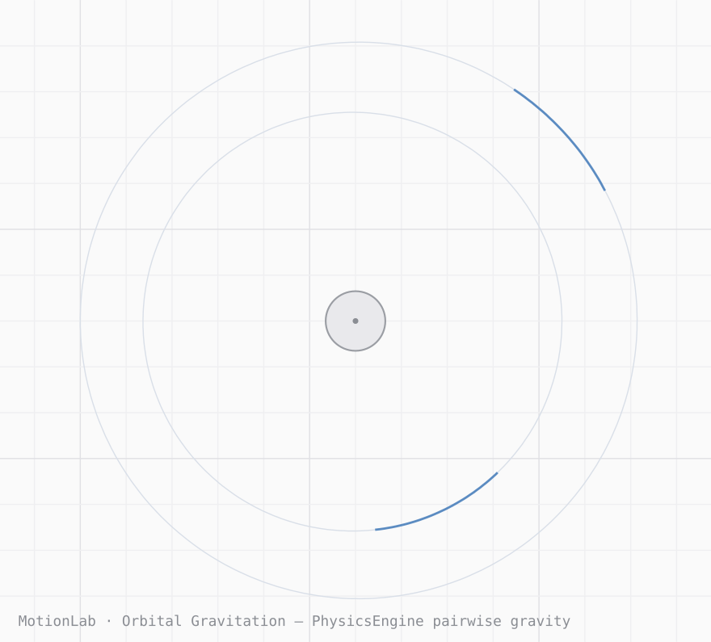

# MotionLab — 2D Physics Sandbox

[](LICENSE)


[](https://xieyuke2026-cpu.github.io/Physics-engine/)

## English

**MotionLab** is a browser-based 2D physics sandbox powered by **Matter.js**: create rigid bodies, tune gravity, friction and elasticity, connect springs and rods, add pairwise gravitation and fluid buoyancy, then save experiments as portable JSON scenes. No build step, no backend — open the page and play, on desktop or tablet.

Its physics layer, **PhysicsEngine**, is a standalone open-source 2D physics core designed for reuse — copy `js/engine/physics-engine.js` plus `vendor/matter.min.js` into your own project. Features: fixed-timestep simulation with sub-stepping, seeded RNG, named bodies, pairwise gravitation, fluid regions (buoyancy), a formulas library, and spatial queries (region / raycast). A platform-fighter prototype, **PFLab**, is built on the same core.

- **Live demo**: https://xieyuke2026-cpu.github.io/Physics-engine/
- **Examples**: [Orbital gravitation](https://xieyuke2026-cpu.github.io/Physics-engine/examples/orbit.html) · [Fluid buoyancy](https://xieyuke2026-cpu.github.io/Physics-engine/examples/buoyancy.html) · [Seeded Galton board](https://xieyuke2026-cpu.github.io/Physics-engine/examples/galton.html)
- **Developer docs**: [docs/DEVELOPER-EN.md](docs/DEVELOPER-EN.md) — API reference and integration guide (中文版：[docs/DEVELOPER.md](docs/DEVELOPER.md))
- **License**: MIT

中文完整文档在下方 ↓ Full documentation in Chinese below.

一个运行在浏览器中的 2D 物理模拟与实验平台。基于 **Matter.js** 的真实刚体物理：
重力、碰撞、摩擦、弹性、旋转与不同质量的物体，都可以在画布中创建、拖拽、调参并保存为实验场景。

设计关键词：Minimalist · Scientific · Interactive · Responsive · Lightweight。
黑白灰为主、低饱和蓝为强调色的科学软件风格界面，全部图标为统一线条风格的 SVG（无 Emoji 功能图标）。

## 在线使用 / 本地运行

- GitHub Pages：仓库启用 Pages 后访问 `https://xieyuke2026-cpu.github.io/Physics-engine/`
- 本地：任意静态服务器即可，例如在本目录执行 `python3 -m http.server 8000` 后打开 `http://localhost:8000`
- 无后端、无构建步骤、无 API Key；直接部署静态文件即可（GitHub Pages 兼容）。
- **开发者文档**：[docs/DEVELOPER.md](docs/DEVELOPER.md) —— PhysicsEngine 与
  **PF 引擎**的完整调用方式（API 速览、无头对局与 UI 壳示例、AI 档位与调参）。
  English version: [docs/DEVELOPER-EN.md](docs/DEVELOPER-EN.md).

## 开源与 PhysicsEngine

本仓库以 **MIT 许可证开源**（见 [LICENSE](LICENSE)），主目标之一就是把物理核心
做成一个**任何项目都能直接复用的开源引擎**：

- **PhysicsEngine**（`js/engine/physics-engine.js`）：与应用无关的 2D 物理核心——
  纯数据描述符、固定步进、种子随机、物体命名、万有引力、流体浮力、磁力、风场、Formulas 公式库。
  复制这一个文件（加 `vendor/matter.min.js`）即可在你自己的项目里用。
- **在线示例**（GitHub Pages 可直接打开）：
  [万有引力轨道](https://xieyuke2026-cpu.github.io/Physics-engine/examples/orbit.html) ·
  [流体浮力](https://xieyuke2026-cpu.github.io/Physics-engine/examples/buoyancy.html) ·
  [种子钉板](https://xieyuke2026-cpu.github.io/Physics-engine/examples/galton.html)
  （源码在 `examples/`）
- **PF 引擎**（`js/pf/`）：建立在 PhysicsEngine 之上的平台格斗模块，同样可独立调用。
- 参与开发：[CONTRIBUTING.md](CONTRIBUTING.md) · 更新记录：[CHANGELOG.md](CHANGELOG.md) ·
  测试报告：[TEST-REPORT.md](TEST-REPORT.md)

## 功能

**物理（Matter.js 真实模拟）**
- 重力（X/Y 可调、可关闭）、碰撞检测、摩擦力、弹性碰撞、刚体旋转、静态/动态物体
- 物体类型：圆形 Circle、矩形 Rectangle、正多边形 Polygon、三角形 Triangle、静态线段 Static Line（斜坡）
- **弹簧 / 连杆约束（v1.1）**：两点式放置——物体↔物体、物体↔固定锚点；低刚度渲染为弹簧线圈，
  高刚度（≥0.9）渲染为直杆（可做单摆/牛顿摆）；删除物体自动清理其约束，删除工具点按弹簧线可单独删除弹簧
- 地面与左右墙壁作为场景框架物体，可选中、调参、删除

**交互**
- 工具：选择、移动、圆形、矩形、多边形、三角形、线段、磁铁、弹簧、铰链、冲击波、删除（左侧工具栏按「选择 / 创建 / 连接 / 作用」分组，带悬停操作说明）
- 点按放置 / 拖拽定尺寸创建物体；约束拖拽（运行中拖拽是真实物理约束，可投掷物体）
- 画布缩放（滚轮 / 双指捏合 / 工具按钮）与平移（移动工具拖拽空白、双指拖动）
- 选中高亮（蓝色描边 + 虚线包围盒）
- 播放 / 暂停 / **单步运行一帧** / 重置、Undo / Redo、空格播放暂停、Delete 删除
- 快捷键：Ctrl+D 复制物体、方向键微调位置（Shift=10px）、R 旋转 15°（Shift+R 反向）
- **画布截图导出 PNG**（顶部相机按钮）；**录制导出 GIF**（顶部「录制」按钮，v1.28：12 fps、最长 20 秒，零依赖自研 GIF 编码器）

**实验预设（共 20 个，首页卡片带概览图，点卡片或按钮一键载入并自动运行）**
- 牛顿摆（5 球刚性摆杆）、多米诺骨牌、方块金字塔、斜坡滚球、高弹球阵列
- **v1.6 新增**：双摆混沌（双连杆 + 轨迹）、桥梁承重（弹簧链桥面 + 重载）、钉板概率（高尔顿板）、
  蹦床弹簧网（弹性网兜住落体）、漏斗沙漏（小球穿 V 型漏斗）
- **v1.9 新增**：过山车回环、保龄球（重球撞三角瓶阵）
- **v1.23 新增**：万有引力轨道（两两引力下的双行星轨道）、浮力池（软木/木块/铁块按密度浮沉）
- **v1.25 新增**：磁铁阵列（固定磁铁把磁球按极性分拣、铁球被吸附）、风洞实验（泡沫球被吹进收集区、铁块原地不动）
- **v1.26 新增**：材质实验室（泡沫/木头/橡胶/冰/铁五种材质的球同坡竞速）、磁铁秋千（S 极摆球被固定 N 极磁铁吸偏，不再直上直下）
- **v1.27 / 引擎 1.6.0**：性能优化（行为不变）——引擎两两力通道零分配、引力循环按动态/静态分区（静态多的世界配对通道约快 40%）、渲染逐帧零拷贝
- **v1.28 新增**：马达风车（马达驱动的转子风车）、摩天轮（十字轮 + 四个自由铰链座舱）
- **v1.28 / 引擎 1.7.0 机械**：铰链工具把两个物体钉在同一点上相对转动，可加马达匀速驱动（转速面板可调）；同一台机器的零件互不碰撞，折叠旋转不卡角。顶栏新增录制按钮，一键把实验录成循环 GIF
- **v1.10 修复**：过山车回环重做——v1.9 的圆环是封闭的且小球从环下穿过，根本进不去；
  新版改为导杆回环：小球由一根刚性导杆牵引，沿 24 段轨道圆环内侧完整绕行约 1.7 圈后
  逐渐摆动停稳（自由滚动在分段轨道上会因段角卡滞与能量不足无法完成整圈，实测对比后选导杆方案）

**防穿模（v1.10）**
- 通用引擎新增 `substeps`（子步进）：每个固定步拆成多个引擎更新，单次位移随之减小，
  高速物体不再跳过薄碰撞体。MotionLab 默认 2；引擎单测证明同一发 36px/步 的高速球：
  substeps=1 时穿透 12px 薄墙、substeps=4 时被正常挡下
- 例外：用户拖动是位置驱动的约束，按需求不做防穿限制（拖动仍可把物体拉过薄墙）

**冲击波工具（v1.9）**
- 左侧工具栏「冲击波」：在画布任意点点按，产生径向冲击——半径 280 内的动态物体按距离衰减
  获得向外的速度，伴随扩散光环特效；适合一键打散堆叠、给场景「重启」一下

**渲染优化（v1.9）**
- 每帧只取一次刚体列表（此前主体、轨迹、速度矢量各自复制一份）；网格线改为纯算术投影，
  不再逐线分配坐标对象；轨迹的存活集合改为复用，休眠物体不再记录轨迹点

**3D 界面已下线（v1.7 加入，v1.8 起隐藏，v1.20 清理残留）**
- 3D 实验室界面不再提供入口：`FEATURE_3D = false` 之外，页面带有 `body.no-3d`
  结构护栏，模式切换与首页的 3D 分组在样式层即被隐藏，不依赖脚本时序。
  3D 核心代码与已存的 3D 场景数据保留未删；PhysicsEngine3D 的独立用法见
  [开发者文档](docs/DEVELOPER.md)。

**物理引擎优化（v1.6）**
- 刚体列表缓存：结构变化时才重建，`pick()` / `allBodies()` 不再每次调用都复制整个列表
- 旋转锁定的每步清零从「遍历全部刚体」改为只遍历锁定集合（O(锁定数)），大场景步进更省
- 两份引擎副本（MotionLab 内置 + 独立复用包）保持同步

**属性面板（右侧，可折叠）**
- 选中物体：**名称（可重命名，v1.23）**、类型、位置 X/Y、宽/高或半径、边数、质量、密度、摩擦力、**空气阻力**、弹性、角度、速度 X/Y、静态开关、**锁定旋转**
- **实时数据读数**：速率 |v|（px/s）、动能 KE、角速度（°/s）、动量 |p|，模拟运行时实时刷新
- **物体操作**：停止运动、水平/垂直翻转速度
- 所有修改实时同步到物理引擎（尺寸修改通过原地重建保持 id 与材质参数）
- 未选中时显示场景属性：**重力预设**（月球/地球/木星/零重力/侧向）、重力 X/Y、模拟速度、重力开关、
  **世界效应（v1.23 起，v1.25/v1.26 扩充）：万有引力 G、流体区域（浮力）与风场区域的添加/编辑，流体/风场区域可在画布上直接拖动改位置；左侧工具栏有专门的磁铁工具（世界效应节也有添加按钮），物体「材质」一节可设磁性（+N/−S 极，同极相斥、异极相吸、吸铁），还有泡沫/木头/橡胶/冰/铁一键材质预设**、
  网格 / 速度向量 / **运动轨迹**显示开关、**物体列表**（点选定位、单删）

**项目管理**
- **「我的项目」首页（v1.4 起，v1.5 成为启动首页）**：打开应用（首次落地页之后）先到这里——
  左侧**侧边栏**（概览 / 场景库 / 实验预设，带计数，底部「进入实验室」），右侧是当前场景卡（保存/继续编辑）、
  自动保存恢复卡、实验预设与已保存场景卡片网格；每张卡带按场景数据绘制的**缩略图**、物体/弹簧数、
  更新时间，以及打开 / 重命名 / 复制 / 导出 / 删除操作；可按名称搜索。
  在实验室里点顶部「我的项目」或左上角 Logo 随时回首页；窄屏时侧边栏自动变为顶部横条
- 新建 / 保存 / 加载 / 重命名 / 复制 / 删除场景（场景库存于 localStorage）
- 导出 / 导入 JSON（格式 `motionlab-scene` v2，含 `constraints`；v1 文件可继续导入，导入时完整校验，错误会逐条提示）；**主页工具栏也有「导入场景」入口**，不必先进实验室
- **分享链接（v1.25）**：点顶部或场景卡上的「分享」，整个场景被压缩编码进链接（`#s=` 哈希，无后端），对方打开链接直接进入这个场景
- 自动保存：刷新页面后恢复上次场景

**状态栏**：FPS、物体数量、模拟状态、重力、模拟速度、缩放比例。

### PFLab · 平台格斗实验室（1.14 新增）

基于同一个 PhysicsEngine 核心构建的 2D 平台格斗原型（`js/pf/`，独立模块，不影响实验室）：

- **场地**：主平台 + 两块单向浮台，场地外为击飞区；玩家左侧出生，AI 假人右侧出生。
- **角色控制**：独立于引擎的角色控制器——地面/空中移动、二段跳（土狼时间 + 跳跃缓冲）、冲刺（带冷却）、朝向切换。
- **战斗**：攻击分启动/生效/恢复三段，独立攻击判定框（非身体碰撞）；命中累积伤害 %，击飞距离随伤害增长，一次攻击只命中一次。
- **AI 假人**：确定性状态机（待机/接近/攻击/后退/回场），每 10 步决策一次，考虑距离、位置、边缘危险与自身冷却，无逐帧随机。
- **胜负**：任一方被打出击飞区即判负，显示结果与再来一局；暂停时模拟完全冻结。
- **操作**：键盘 A/D 移动、W 跳跃、J 攻击、K 冲刺；iPad 触屏虚拟键（左方向、右跳/攻/闪，多点触控）。右侧调试面板实时显示双方状态、伤害、速度、FPS 与命中信息。
- 入口：主界面（首页）侧边栏的「PFLab 平台格斗」按钮；退出时释放全部监听与物理资源，返回主界面。

**新版本提示**：页面打开与切回前台时以 no-store 方式读取 `version.json`，若线上版本与运行版本不一致，顶部出现「发现新版本」提示条，一键刷新到最新版，避免浏览器缓存导致一直使用旧版。

## 项目结构

```
index.html            页面骨架（顶栏 / 左工具栏 / 画布 / 右面板 / 状态栏 / 弹窗）
css/style.css         全部样式（黑白灰 + 低饱和蓝，iPad 13" 横屏优先）
js/icons.js           统一 SVG 图标集（1.7 线宽、24 网格）
js/scene.js           纯数据层：场景/物体数据模型、默认值、导入校验（无 DOM 依赖，可单测）
js/engine/physics-engine.js  通用可复用物理核心（v1.2 抽出）：固定时间步累加器、休眠、
                      描述符建体/序列化、弹簧约束管理、物理拖拽——与 MotionLab 格式无关，
                      独立包在 ~/workspace/physics-engine/，新项目可直接调用
js/physics.js         薄适配层：MotionLab 场景格式 ⇄ 通用引擎描述符的翻译
js/render.js          Canvas 渲染器 + 相机（网格、选中高亮、速度向量、创建预览、视口裁剪）
js/ui.js              右侧属性面板与设置弹窗的 DOM 构建
js/storage.js         localStorage：场景库、自动保存、UI 设置（损坏数据自动回退）
js/app.js             应用装配：工具与指针交互、历史记录、场景管理、主循环
vendor/matter.min.js  Matter.js 0.20.0（本地托管，不依赖 CDN 在线可用性）
tests/run-tests.mjs   Node 逻辑测试：`node tests/run-tests.mjs`
```

UI、物理引擎、场景管理三层分离：`ui.js` 不直接接触 Matter，`physics.js` 不操作 DOM，
`scene.js` 是可独立测试的纯数据模块。

**v1.2 引擎优化**：物理层抽成通用引擎（见上），主循环改由引擎的固定时间步累加器驱动
（任意刷新率下物理一致，带防螺旋死亡上限）；启用刚体休眠（静止堆积自动睡、碰撞/编辑/拖拽自动醒）；
渲染增加视口裁剪（画布外物体不绘制）与约束线段缓冲复用（逐帧零分配）。基准：201 个物体 × 120 步
约 110ms（≈0.9ms/步，Node，休眠开）。

**v1.3 首次启动落地页**：第一次打开 MotionLab 时先显示欢迎落地页——产品介绍、与实验室共用
同一台物理引擎的实时演示（掉落的形状 + 弹簧吊球）、五个实验预设的快速入口（点一下直接载入并运行）。
点「开始使用」后写入本机标记，之后打开直接进入实验室；设置中可随时点「显示欢迎页」重看。
清除全部本地数据会一并重置该标记。

**v1.13 版本号体系与弹窗层级**：MotionLab / PhysicsEngine / Matter 三方版本号补齐并各自
单一来源——应用版本在 `js/ui.js` 的 `APP_VERSION`；PhysicsEngine 导出 `VERSION` /
`PhysicsEngine.VERSION`（3D 核心为 1.0.0）；Matter 版本运行时读实际加载的
`Matter.version`。当前各组件版本见 [开发者文档的版本表](docs/DEVELOPER.md)。同时修复
设置弹窗层级：弹窗 z-index（100）曾低于首页（150），在主界面点设置会开在首页下层、
进实验室才显形；现弹窗 300、toast 400，设置在主界面点击即在主界面上打开。

**v1.12 设置入口与开发者文档**：设置图标由无辨识度的「太阳」改为标准齿轮；设置不再只藏在
实验室顶栏——首页（我的项目）侧边栏底部新增「设置」按钮，首页即可打开同一设置面板。
首页侧边栏新增「开发者文档」视图：说明如何下载 MotionLab / 通用物理引擎 PhysicsEngine
（整站 ZIP、git clone、引擎两文件直链），以及如何调用引擎（Matter 加载方式、最小示例、
API 速览与坐标约定），内容与 `js/engine/physics-engine.js` 源码一一对应。

**重置数据（v1.11）**：设置 →「重置数据（恢复初始）」= 恢复出厂：一次性删除全部六个本地
存储键（2D 与 3D 场景库、两份自动保存、UI 偏好、首次访问标记），运行时状态同步归零——
设置回默认、当前场景回默认场景、（隐藏中的）3D 实验室内存场景回默认，并回到首页（空场景库）。
旧的「清除全部本地数据」只删了四个键且不重置内存中的设置，本版补齐（含 3D 数据与 3D 内存状态，
且先重置 3D 内存再清存储，防止其自动保存把旧数据写回）。下次打开会重新出现首次欢迎页。

## 数据格式

导出 JSON 示例（节选）：

```json
{
  "format": "motionlab-scene",
  "version": 2,
  "name": "Untitled Scene",
  "settings": { "gravityX": 0, "gravityY": 1, "gravityEnabled": true, "speed": 1, "showGrid": true, "showVectors": false, "showTrails": false },
  "bodies": [
    { "id": "body-…", "type": "circle", "x": 380, "y": 120, "radius": 30,
      "density": 0.001, "friction": 0.3, "restitution": 0.55, "isStatic": false, "lockRotation": false }
  ],
  "constraints": [
    { "id": "spring-…", "bodyA": null, "bodyB": "body-…",
      "pointA": { "x": 380, "y": 40 }, "pointB": { "x": 0, "y": 0 },
      "stiffness": 0.08, "damping": 0.05, "length": 80 }
  ]
}
```

保存的是物理对象与参数本身，不是截图；导入后会完整重建物理世界。

## GitHub Pages 部署

仓库 Settings → Pages → Source 选择 `Deploy from a branch`，分支 `main`、目录 `/ (root)`，保存即可。
本站为纯静态文件，根目录 `index.html` 即入口，无需 Actions 构建。

## 已知问题

- 画布世界未做无限边界管理：把物体拖到很远处后需用「适应画布」按钮找回视角。
- 密度下限做了保护（≥0.00001），极端参数组合（如弹性 1 + 高速）仍可能出现 Matter.js 固有的轻微抖动。
- 深色模式未实现（设计已预留，后续可扩展）。
- Apple Pencil 专属功能未实现（按需求暂缓）。

## 测试

`node tests/run-tests.mjs` — 覆盖场景校验、重力下落与地面碰撞静止、重力关闭、
拾取/删除、密度/质量/摩擦/弹性/位置/角度/速度/静态切换同步、尺寸重建、
约束拖拽、序列化 JSON 往返、速度倍率；v1.1 新增：v1/v2 格式兼容与约束校验、
刚性摆杆长度保持、软弹簧拉近、约束生命周期与往返、锁定旋转、空气阻力、停止运动、全部预设的校验与载入（含 v1.23 的轨道稳定性与浮沉分层实测）。
`node tests/smoke.mjs` — jsdom 真实 UI 冒烟（启动/运行/创建/编辑/保存/撤销/预设/弹簧工具/单步/物体列表）。
结果见 TEST-REPORT.md。
